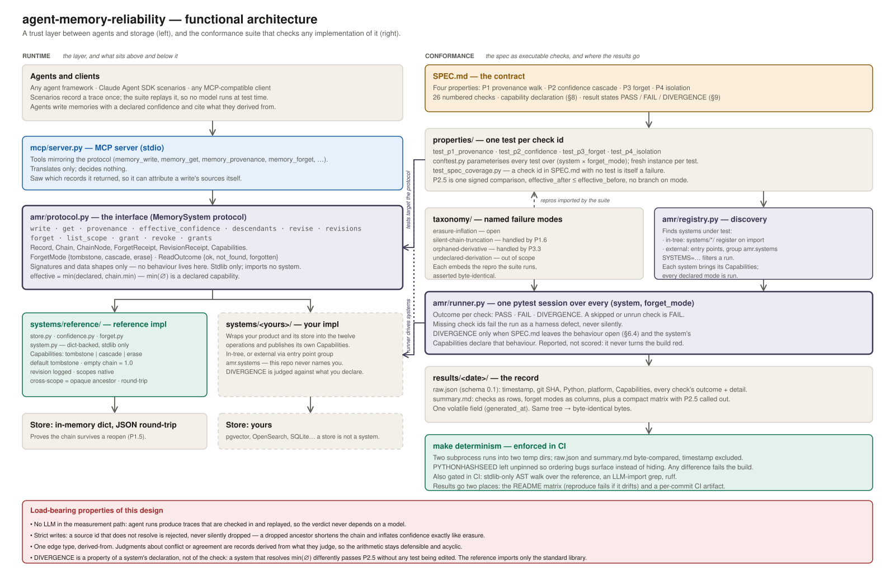
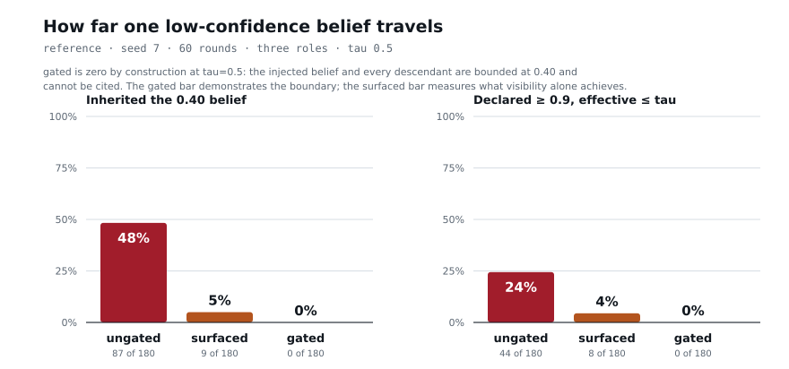

# agent-memory-reliability

An agent writes a conclusion it derived from something it read last week. Nothing records
that derivation, so nothing can tell you the conclusion rests on a note someone has since
retracted. Retrieval benchmarks measure whether the right memory comes back. They do not measure
whether it can be trusted given where it came from — whether its provenance is walkable, its
confidence bounded by its weakest evidence, the consequence of deleting that evidence defined,
and another agent's scope kept out. This repository specifies those four properties as
falsifiable checks, ships a reference implementation, and runs a conformance suite against it
with no model anywhere in the measurement path.

## Architecture



Left, the layer. Right, the suite: one test per numbered check, over every system × mode.

## The four properties

**P1 — Provenance walk across writes.** Every write records what it was derived from, and the
walk from any descendant to its roots is complete, terminating, acyclic, free of dangling
identifiers, and unchanged across a reopen. A write citing a source that does not resolve is
rejected.

**P2 — Confidence cascading along the chain.** `effective(m) = min(declared(m), min over
effective(sources))`, with `min` over the empty set defined as 1.0. Lowering trust in evidence
lowers everything derived from it; a shared ancestor in a diamond constrains the sink once;
raising an ancestor does not lift a descendant past its own claim.

**P3 — Forget operations.** Forgetting makes a memory unreadable and has a declared, observable
effect on its descendants — `tombstone`, `cascade` or `erase`. It is idempotent, it cannot be
undone by rewriting the same content, and it returns a receipt naming the mode, every affected
identifier and every confidence that moved.

**P4 — Isolation when agents share state.** Scopes cannot read each other without a recorded,
revocable grant; a cross-scope ancestor contributes confidence without leaking content; a
forget crosses the boundary; interleaved writes produce one well-formed DAG.

The normative text is [version2/SPEC.md](version2/SPEC.md), draft v0.6: 26 numbered checks, one
test each.

## The finding: erasure inflation

`min` over an empty chain is 1.0: a record with no ancestors is bounded only by its own claim.
Correct for roots. It also means a forget that genuinely removes an ancestor shortens its
descendant's chain, so `min` runs over a smaller set:

```
source(0.4) <- derived(declared 0.9)      effective(derived) = min(0.9, 0.4) = 0.4
forget(source, mode=erase)
derived(declared 0.9), chain empty        effective(derived) = min(0.9, 1.0) = 0.9
```

Forgetting the evidence strengthened the conclusion. Nothing is corrupted, no invariant breaks,
no error is raised, and the number a downstream reader trusts went up. Under `tombstone` the
value does not move; under `cascade` the derivative does not survive to be inflated; under
`erase` it is guaranteed. The suite reports a DIVERGENCE rather than scoring it, because
[SPEC.md §6.4](version2/SPEC.md) leaves the tension open and every way out costs something
real. The same number is reachable with no deletion at all — [taxonomy/](taxonomy/). To watch
it: `python examples/erasure_inflation.py`.

## Results

| Property | tombstone | cascade | erase |
|---|---|---|---|
| P1 — Provenance walk across writes | PASS | PASS | PASS |
| P2 — Confidence cascading along the chain | PASS | PASS | DIVERGENCE |
| P3 — Forget operations | PASS | PASS | PASS |
| P4 — Isolation when agents share state | PASS | PASS | PASS |
| **P2.5 — Forget weakest ancestor, re-read leaf** | **PASS** | **PASS** | **DIVERGENCE** |

One column per forget mode; the per-check table, the declaration and the raw record are in
[results/](results/). A property row is PASS only if every
check in it passed. P2.5 is one signed comparison, `effective_after <= effective_before`, with
no branch on the mode: the divergence comes from the declaration, not from the check expecting
it. `make reproduce` fails if this table drifts.

## How far one bad memory travels



Three simulated agents — `support-triage`, `sre`, `platform` — share one store for sixty
rounds. In round one, two conflicting beliefs about the same fact are written: the runbook's
`p99 SLO is 250ms` at 0.95, and a chat message's `p99 SLO is 400ms` at 0.40. Nothing after that
is special-cased. Deterministic policies over a seeded PRNG; no model in the loop.

| arm | writes | inherited the 0.40 belief | declared ≥ 0.9 while effective ≤ 0.5 | depth |
|---|---|---|---|---|
| ungated | 180 | 87 (48%) | 44 (24%) | 9 |
| surfaced | 180 | 9 (5%) | 8 (4%) | 3 |
| gated (τ = 0.5) | 180 | 0 (0%) | 0 (0%) | 0 |

In `ungated`, effective confidence is computed and ignored: nearly half of what was written
descended from the weaker of two beliefs nobody reconciled, and a quarter was stated at 0.9 or
above while its effective confidence sat at 0.40. In `surfaced` nothing is blocked and agents
merely prefer stronger evidence; that alone takes inheritance to 5%. In `gated`, a memory below
τ may still be read but may not be **cited**.

**gated is zero by construction at τ = 0.5: the injected belief and every descendant are bounded
at 0.40 and cannot be cited, so that bar demonstrates the boundary where the surfaced bar
measures what visibility alone achieves.** `make contamination` reproduces all three; same seed,
same bytes.

## Reproduce

```
git clone https://github.com/ratnopam/agent-memory-reliability && cd agent-memory-reliability
make reproduce         # the suite, results/<today>/, the summary
make determinism       # twice in fresh subprocesses, compared byte for byte
```

Python 3.11+ and pip. `pytest` is the only dependency; nothing is vendored, no model is called. Every target wraps the `amr` command line, which is the real interface:
`amr test | reproduce | determinism | demo | contamination | matrix | drift | replay | systems`. `make demo`
prints the declaration, the matrix and the divergence in fifteen lines; `make release-check` runs every
gate, one line each.

The matrix above is the **default** run. `make systems` lists what this checkout can measure; an
adapter with an optional dependency is an **extra**, measured only when you name it
(`SYSTEMS=sqlite python -m amr reproduce`) or run `make extras`, which writes
`results/extras/<date>/` and can never move the published table.

## Use it

**From Claude Desktop, no terminal after setup.** `pip install -e ".[mcp]"`, point Desktop at
`mcp/server.py`, and the layer is ten MCP tools. The numbers come from the tool, not from the
model. [docs/try-it-with-claude.md](docs/try-it-with-claude.md) is a scripted run with the
expected value for every step, checked by `make mcp-test` against a real server;
[mcp/README.md](mcp/README.md) is the server. Start it with `--trace FILE` and `amr replay FILE`
re-runs the session and compares every value it recorded.

**From Claude Code**, ask it to run the suite:
[.claude/skills/conformance-run/SKILL.md](.claude/skills/conformance-run/SKILL.md) is a skill that
measures a declared system into a scratch directory and explains the matrix it got, including what
each FAIL requires and which capability field it follows from.

**From Python**, in full — this is [examples/use_it.py](examples/use_it.py) verbatim:

```python
"""The whole layer in one screen: write a chain, read the bound, forget the middle.

Run it with ``python examples/use_it.py``. Nothing is configured and no model is called.
"""

from amr.registry import named

memory = named("reference")  # default forget mode: tombstone

incident = memory.write("checkout p99 regressed after the deploy", 0.90)
hearsay = memory.write("someone in chat says it is the memory leak again", 0.40,
                       sources=[incident])
summary = memory.write("root cause: the memory leak", 0.95, sources=[hearsay])

print(f"declared  {memory.get(summary).record.declared_confidence:.2f}")
print(f"effective {memory.effective_confidence(summary):.2f}  <- bounded by the hearsay")

receipt = memory.forget(hearsay)
print(f"\nforget({hearsay}) mode={receipt.mode.value} forgotten={sorted(receipt.forgotten)}")
for delta in receipt.deltas:
    print(f"  {delta.id}: {delta.before:.2f} -> {delta.after:.2f}")
print(f"get({hearsay}) -> {memory.get(hearsay).outcome.value}")
print(f"effective {memory.effective_confidence(summary):.2f}  <- the bound survived the forget")
```

```
declared  0.95
effective 0.40  <- bounded by the hearsay

forget(m002) mode=tombstone forgotten=['m002']
  m003: 0.40 -> 0.40
get(m002) -> forgotten
effective 0.40  <- the bound survived the forget
```

A summary claiming 0.95 is bounded at 0.40 by the chat message two steps up it; the forget is a
receipt rather than a return code; and the tombstone holds the bound where `erase` would raise it
to 0.95. The snippet above, its output, and the file are asserted equal by the suite.

## Add your system

Implement `amr.protocol.MemorySystem`, declare `Capabilities`, and publish an entry point from
your own package — no edit to this repository:

```toml
[project.entry-points."amr.systems"]
your-system = "your_package:factory"
```

The suite is parameterised over every registered system × mode, so a new adapter adds columns
without a test being edited, and `SYSTEMS=<name> make test` runs one.
[docs/adding-a-system.md](docs/adding-a-system.md) is the guide;
[examples/external-adapter/](examples/external-adapter/) is a working adapter that fails three
checks on purpose, because its declaration says it will.

## Store alone, and with the layer

One long-term store, measured twice. `langgraph-store` is the store's own five operations — put,
get, search, delete, list namespaces — with nothing computed over them. `langgraph-layered` is the
same store underneath [systems/persistent/](systems/persistent/), which answers the specification's
questions with the reference's semantics and the store's storage. Both are extras:
`pip install -e ".[langgraph]"`, then `make extras`.

A **FAIL** in the first column means *this store does not provide this operation*, not *this store
is broken*. A document store was not built to walk a provenance graph or bound a confidence, and
every refusal here is a named exception saying so rather than an invented value — a store that
answered an empty walk and a default confidence of 1.0 would have scored better while being the
failure this suite exists to catch. The gap is the measurement: twenty-five of twenty-six checks,
and the one that passes does so because a scope is a namespace, so isolation is the store's own
addressing. Both columns are at `tombstone`, the one forget mode both declare.

| Check | Scenario | langgraph-store | langgraph-layered |
|---|---|---|---|
| P1.1 | Write citing an id that has not been assigned | FAIL | PASS |
| P1.2 | Three-hop chain, walk from leaf | FAIL | PASS |
| P1.3 | Diamond graph, walk from sink | FAIL | PASS |
| P1.4 | Walk after an ancestor is forgotten | FAIL | PASS |
| P1.5 | Walk after store reopen | FAIL | PASS |
| P1.6 | Write citing an unresolvable source id | FAIL | PASS |
| P1.7 | Deserialise a store containing a cycle | FAIL | PASS |
| P2.1 | Chain 0.4 → 0.9, read leaf | FAIL | PASS |
| P2.2 | Revise root 0.9 → 0.2, read leaf | FAIL | PASS |
| P2.3 | Diamond with one weak ancestor | FAIL | PASS |
| P2.4 | Root with no sources, declared 0.7 | FAIL | PASS |
| P2.5 | Forget weakest ancestor, re-read leaf | FAIL | PASS |
| P2.6 | Read revision history after a revise | FAIL | PASS |
| P2.7 | Raise an ancestor above a descendant's declared value | FAIL | PASS |
| P2.8 | Read `effective_confidence` of a record from its owner scope and from a granted reader scope | FAIL | PASS |
| P3.1 | Read a forgotten record | FAIL | PASS |
| P3.2 | Forget twice | FAIL | PASS |
| P3.3 | Forget a mid-chain record | FAIL | PASS |
| P3.4 | Re-write identical content | FAIL | PASS |
| P3.5 | Inspect receipt | FAIL | PASS |
| P4.1 | Write in A, list in B | PASS | PASS |
| P4.2 | Grant, read, revoke, read | FAIL | PASS |
| P4.3 | Cross-scope derivation, walk from B | FAIL | PASS |
| P4.4 | Forget in A with descendants in B | FAIL | PASS |
| P4.5 | Replay a fixed set of interleaved write schedules, each a valid topological order of one plan | FAIL | PASS |
| P4.6 | Reader with a grant attempts `revise` and `forget` on the owner's record | FAIL | PASS |

Generated from `results/extras/<date>/raw.json` and checked by `amr drift`, so the table cannot
drift from the run. `langgraph-layered` also passes under `cascade` and `erase`, with the same single
`P2.5` divergence the reference has and nothing else — the layer closes the whole gap, and nothing
in either adapter imports a model client or configures a semantic index.
[systems/langgraph_store/](systems/langgraph_store/) is the code: 130 lines of field mapping and
refusals for the first column, and 80 of address translation and paging for the second.

## Add a failure mode

Write `taxonomy/repro/<slug>.py` with a `reproduce(system) -> dict` over `amr.protocol` only,
write `taxonomy/<slug>.md` embedding that module's source, and register it in
`properties/test_taxonomy.py`. The suite runs the reproduction against every registered system
and asserts the embedded snippet is byte-identical to the code that ran, so an entry cannot
drift from what it describes.

## Against retrieval benchmarks

Orthogonal, not competing. LoCoMo, LongMemEval and BEAM ask whether the right memory comes back
for a query; every check here assumes it came back and asks what can be trusted about it. A
system can score perfectly here and retrieve badly, or the reverse.

## Prior art

The provenance model is a deliberately small subset of W3C PROV and of warehouse-tradition
data lineage: one node type, one edge type (*derived from*), no typed relations, no agent or
activity distinction. Added to it: the confidence arithmetic over that graph, the requirement
that deletion have a declared and observable effect on descendants, and the treatment of a
shortened chain as a first-class failure mode rather than an integrity error. Judgments —
contradiction, corroboration, supersession — are records derived from what they judge, not
edge types, which keeps the arithmetic terminating and any model that produced one upstream
of this layer.

## Limitations

- It cannot make an agent act on the number. A bounded confidence is available; whether a policy
  reads it is above this layer.
- It cannot detect an undeclared source. An agent that reads a memory and writes a conclusion
  without citing it produces a record indistinguishable from an original observation. Catching
  that needs a model in the measurement path, which costs determinism. See
  [taxonomy/undeclared-derivation.md](taxonomy/undeclared-derivation.md).
- It does not judge conflicts. Deciding that two memories contradict requires semantics.
  Representing the judgment is in scope; making it is not.
- It does not measure retrieval quality. See above.

## License

Apache 2.0. Contributions take two forms, results and specification feedback — see
[CONTRIBUTING.md](CONTRIBUTING.md). Releases are tagged.
